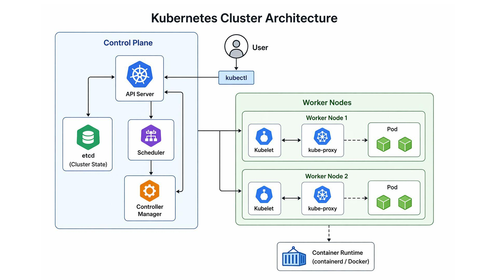
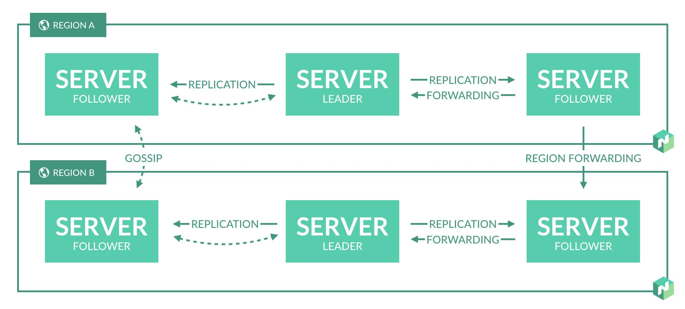
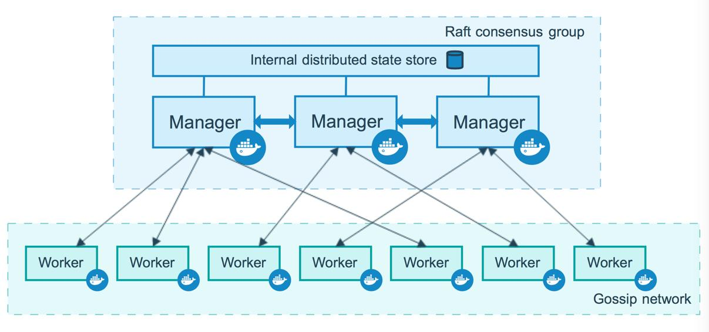
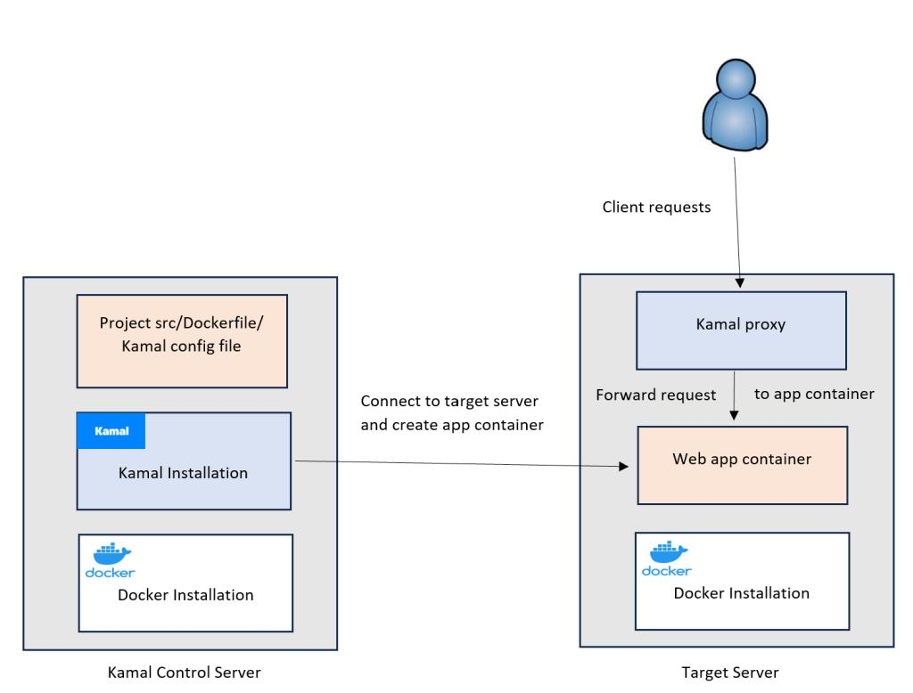

# L'orchestration sous toutes ses formes

2014...Voici l'année ou j'ai mis les mains, pour la première fois, sur **Docker** et **Kubernetes** et chacun d'eux à évolué depuis ce temps. On peut dire que je fais partie des **Early Adopters**, j'ai connu les différentes versions, les tentatives de certains concurrents à proposer des alternatives crédibles.  
Cependant l'objectif de cet article n'est pas de revenir sur la genèse de **Rancher**, de **Kontena** ni même sur l'idée de base d'**Openshift** ou même sur le déclin d'**Apache Mesos**.  

Ici je vais effectuer un tour d'horizon de **Kubernetes**, **Hashicorp Nomad**, **Docker Swarm** et **Kamal**.

## Let's go
Il est vrai que j'aurais pu ajouter **Apache Mesos** à ce tour d'horizon, mais le projet est bien trop ancien et désormais indisponible au grand public...à moins de faire un tour dans [Apache Attic](https://attic.apache.org/projects/mesos.html) ainsi qu'**Openshift** et **Rancher**, mais ceux-ci étant *globalement* des surcouches graphique de **Kubernetes** (à prendre avec des guillemets, je précise), j'ai préféré opter pour des solutions réellement indépendantes en terme de technologie.  
Ce tour d'horizon ne concernera donc que :  
- Kubernetes,  
- Docker Swarm,  
- Hashicorp Nomad,  
- Kamal  

### Docker Swarm
Docker Swarm est le système d’orchestration de conteneurs intégré directement à Docker Engine. Il transforme plusieurs hôtes Docker en un cluster unique capable de déployer, répliquer, mettre à jour et superviser des services conteneurisés, avec équilibrage de charge et reprise automatique en cas de panne.

### Hashicorp Nomad
HashiCorp Nomad est un orchestrateur de charges de travail permettant de déployer et gérer des conteneurs, applications classiques, microservices et traitements batch sur des infrastructures cloud ou sur site. Il se distingue notamment par une architecture relativement compacte, son ordonnanceur performant et sa capacité à gérer des charges conteneurisées comme non conteneurisées.

### Kamal
Kamal est un outil open source de déploiement d’applications web conteneurisées, développé par **Basecamp/37signals**. Il permet de déployer une application Docker sur des serveurs Linux — machines physiques ou VM dans le cloud — via SSH, avec des déploiements sans interruption et sans imposer une plateforme d’orchestration comme Kubernetes.

---

Une fois les présentations effectuées, l'idée de base de cet article est de passer en revue plusieurs angles, tout en considérant aussi bien les environnements *on-premises* que *Cloud* et *Hybride*. Les angles en questions sont les suivants :  
- [Architecture et Infrastructure](orchestration.md#architecture-et-fonctionnement-interne),  
- [Exploitation et Orchestration](orchestration.md#exploitation-et-orchestration),  
- [DevOps et Intégration CI/CD](orchestration.md#devops-et-intégration-cicd),  
- [Sécurité et Gouvernance](orchestration.md#sécurité-et-gouvernance)

---

## Le positionnement
Chacune des quatre solution ne s'adresse pas forcément au même public de par leur mode de fonctionnement dont voici les détails :  
| Critère | **Kubernetes** | **Nomad** | **Swarm** | **Kamal** |  
| ------- | -------------- | --------- | --------- | --------- |  
| Orchestrateur Natif | Oui | Oui | Oui | Non |  
| Multi-noeuds | Oui | Oui | Oui | Oui |  
| Scheduling Distribué | Oui | Oui | Oui | Non |  
| Auto-Healing | Oui | Oui | Oui | Limité |  
| Auto-scaling natif |	Oui, via composants | Oui, via intégrations | Non | Non |  
| Gestion multi-types de workloads | Oui | Oui | Principalement conteneurs | Conteneurs |  
| Complexité | Élevée | Moyenne | Faible | Faible |  

---

## Architecture et fonctionnement interne
### Kubernetes
**Kubernetes** repose sur une architectuInfrastructurere complètement modulaire, distribuée avec un **Control Plane** composé de :  
- Api-Server : Le point d'entrée de l'API,  
- ETCD : Le stockage distribué de l'état du cluster,  
- Scheduler : Le composant chargé de sélectionneSécurité et Gouvernancer les noeuds sur lesquels la charge de travail sera déployée,  
- Controller-Manager : Le composant chargé de la surveillance de l'état de Cluster  

Mais également de **Workers** chargés d'exécuter les charges de travail, composés de :  
- kube-proxy : Gestion du réseau des *Services*, en fonction de l'implémentation,  
- kubelet : Gestion des pods,  
- ainsi que le Container Runtime : Gère l'exécution des conteneurs en fonction du runtime sélectionné (*containerd*, *cri-o*)

### Nomad
Bien plus simple dans son approche architecturale que le premier, **Nomad** n'intègre que cinq composants :  
- Server : Gère le Control Plane, le scheduler et le stockage de l'état du cluster,  
- Client : Exécute les tâches,  
- Raft : Le protocole développé par **Hashicorp**, également présent dans **Consul** (par exemple), en charge du **Consensus** et de la réplication de l'état,  
- API : Pour l'administration et les intéractions avec le cluster,  
- Task Drivers : Il s'agit d'une couche d'abstraction des moteurs d'exécution

### Swarm
Etant directement intégré à Docker Engine, il repose sur deux rôles différentes : **Manager** (administration du cluster, scheduling) et **Worker** (exécution des conteneurs). A l'instar de **Kubernetes** et de **Nomad**, il peut également être déployé en tant que cluster (via le protocole **Raft**).

### Kamal
Control Plane distribué ?  
Scheduler centralisé ?  
Gestionnaire de cluster ?  
Rien de tout cela n'existe dans **Kamal**, il pilote le tout via des connexions SSH.

---

## Exploitation et orchestration
### Scheduling et placement des workloads
Concernant le **Scheduling**, **Kubernetes** est réellement le plus complet, bien que **Nomad** ne soit pas très loin il ne manquerait que la gestion GPU native. De son côté, **Swarm** propose de nombreuses fonctionnalités mais reste assez limité en ce qui concerne la *fédération* de serveurs ainsi que la gestion GPU et les *affinités*/*antiaffinités*.  
**Kamal** ne propose rien de tout cela, sauf si c'est déjà prévu dans la configuration des serveurs (pas de schéduling automatique).

### Haute disponibilité et auto-healing
En distinguant les niveaux suivants :  
1. Redémarrage d'un conteneur.  
2. Remplacement d'un conteneur défaillant sur un autre nœud.  
3. Continuité du service malgré la perte d'un nœud ou d'un composant d'infrastructure.  

**Kubernetes**, **Nomad** et **Swarm** sont vraiment équivalent en terme de fonctionnalités, bien que le permier cité offre un système de réconciliation bien plus complet que les autres.  
Une limite importante de **Kamal** : si un serveur hébergeant une application tombe, il ne va pas spontanément décider de déplacer cette application vers un autre serveur.

### Auto-scaling
Point extrêmement important pour les infrastructure Cloud et Microservices.  
**Kubernetes** et **Nomad** permettent le **scaling manuel** ainsi que le **scaling horizontal automatique**, mais seul le premier va plus loin en intégrant également le **scaling vertical automatique**.
Du côté de **Swarm**, seul le **scaling manuel** est possible...et rien pour **Kamal**.

### Gestion réseau et service discovery
Là ou **Kubernetes** s'appuie sur un modèle réseau stable reposant sur :  
- Une adresse IP par Pod,  
- Des Services pour fournir des points d'accès stables,  
- Des composants CNI pour le réseau des Pods,  
- Des mécanismes de Gateway et d'Ingress pour les accès externes.

**Nomad** s'appuie sur **Consul** pour : 
- La découverte de services,  
- Les health checks,  
- La configuration dynamique,  
- Le service mesh.

Et **Swarm** dispose d'un système intégré de réseaux overlay, d'un DNS embarqué et du routing mesh tandis que **Kamal** ne fournit pas un véritable réseau de services distribué comparable à celui de **Kubernetes**, bien qu'il propose un proxy faisant office de réseau.

### Stockage persistant et Stateful workloads
**Kubernetes** permet de séparer le cycle de vie des applications de celui du stockage via des objets tels que :  
- PersistentVolume et PersistentVolumeClaim,  
- StorageClass,  
- ContainerStorageInterface,  
- Statefulset (se déploiement comme un Deployment et dispose de configuration de stocage plus complète)

Bien que **Nomad** prenne également en charge les même types de volumes que **Kubernetes**, il faut au préalable prévoir l'infrastructure de stockage ainsi que son intégration.

Avec **Swarm**, les volumes Docker sont utilisables, mais la persistance et la mobilité des données demandent une attention particulière.

**Kamal** de son côté ne gère pas le cycle de vie d'un stockage distribué mais peut monter des volumes Docker persistants.

### Gestion des configurations et des secrets
Sur **Kubernetes**, les ConfigMaps et Secrets permettent de séparer les paramètres de configuration des images applicatives.

L'approche de **Nomad** est plus modulaire :  
- Variables Nomad.  
- Templates.  
- ACL.  
- Intégration Vault pour injecter des secrets.  
L'association Nomad + Consul + Vault constitue une architecture particulièrement intéressante.

**Swarm** propose nativement :  
- Docker Secrets.  
- Docker Configs.  
- Authentification mutuelle TLS entre les nœuds.  
Les secrets sont conçus pour être distribués aux services de manière sécurisée.

**Kamal** propose une gestion plus simple, mais moins complète :  
- Secrets transmis lors du déploiement.  
- Variables d'environnement.  
- Fichiers de configuration.  
- Protection des accès SSH.

---

## DevOps et intégration CI/CD
Ce n'est plus un secret pour personne :  
- Helm,  
- ArgoCD/FluxCD,  
- Kustomize,  
- Tekton

Voici quelques-uns des outils disponible pour déployer sur **Kubernetes** les différents workloads, un écosystème extrêmement vaste et complet permettant de couvrir de nombreux *use-cases*.

**Nomad** également dispose d'un écosystème de plugins, certes moins vaste que celui de Kubernetes. Bien qu'un outils de packaging de workload ne soit pas disponible, la définition de ceux-ci est possible grâce à l'intégration du **HCL** (langage propriétaire d'**Hashicorp** et utilisé avec **Terraform**, **Consul** et **Packer**) et celui-ci est relativement facile à maîtriser.

**Swarm** et **Kamal** sont également extrêmement simple à déployer, via une configuration en YAML et un pipeline intégrant des commandes **Docker**

---

## Sécurité et Gouvernance
**Kubernetes** offre un système de gouvernance ainsi que des possibilité de sécurisation extrêmement complet et puissants :  
- Les ServiceAccounts,  
- Les RBAC,  
- Les namespaces,  
- Les politiques réseau,  
- Les images et les registres.  

Mais son extrême modularité vient avec une contrainte non négligeable : sa grande surface d'attaque qu'il ne faut pas négliger de sécuriser.

Présentant une surface bien plus réduite ainsi qu'une intégration presque naturelle avec **Consul** et **Vault**, **Nomad** propose également des possibilités de sécurisation relativement élevées.

**Swarm** propose des mécanismes de gouvernance et de sécurité granulaire bien moins avancés que les deux premiers malgré l'intégration par défaut de certificats TLS.  
En revanche, **Kamal** est fortement dépendant de la sécurité des serveurs sur lesquels il est déployés, ce qui inclue la configuration de sécurité du service SSH en lui même.

---

## Conclusion
Ma conclusion ?  
Le choix de l'orchestrateur dépendra surtout de l'usage final.  
| Objectif | Solution à privilégier | A noter |  
| -------- | ---------------------- | ------- |  
| Plateforme cloud-native complète | Kubernetes | richesse fonctionnelle - écosystème vaste - pérennité |  
| Alternative crédible à Kubernetes | Nomad | architecture légère - polyvalence - simplicité d'exploitation |  
| Simplicité Docker multi-nœuds | Swarm | simplicité - limites fonctionnelles |  
| Déploiement applicatif simple | Kamal | excellent outil - dans une catégorie différente des orchestrateurs |  

