# La gestion de configuration à la sauce Rudder

Ne connaissant pas du tout Rudder mais ayant envie de le tester depuis de nombreuses années, j'ai profité de mes vacances pour éplucher la documentation technique disponible sur le [site officiel](https://docs.rudder.io/).  
Après mon article sur la [gestion de configuration](https://www.mikamakusa.fr/cloud/confman/), je me suis dit que le moment était venu de vous proposer un lab sur le sujet.  
A la maison, je n'ai pas vraiment de *homelab* à proprement parler...Certains ont des tours de **Raspberry** sur lesquels **Kubernetes** est déployé, d'autres ont des **NAS**, certains dépensent même leur argent avec des serveurs Cloud sur **Scaleway**, **DigitalOcean**, **ArubaCloud** (Oui, il fallait bien que je le place quelque part) ou autre part.  
Rien de tout cela ici...mon portable (**Lenovo** T470 avec 32GO de RAM et un disque SSD assez spacieux), **Vagrant** et **Virtualbox** que j'utilise tout deux depuis plus de dix ans.

## Le besoin
Pour ce lab, je vais avoir besoin de plusieurs serveurs virtuels dont un sera le master...le nombre exact de serveurs généré sera de 6. Voici une idée du schema technique : 
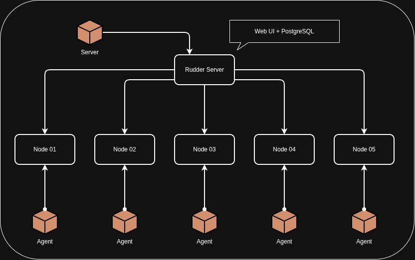
Les spécifications technique sont les suivantes :  
- OS : Ubuntu (24.04 ou plus récent),  
- Réseau : Host-Only, pas de DHCP (adresses fixes),  
- Provisionnement : Script bash (j'aurais pu utiliser Ansible, Salt ou autre chose, mais ce serait ajouter de la complexité à un lab que je voulais simple à suivre).

## Un peu de code
Le **Vagrantfile** ainsi que le script bash se trouvent sur [git](https://github.com/mikamakusa/labs/tree/main/configmanagement/rudder)
Pour le **Vagrantfile**, j'aurais pu conserver celui *de base* que l'on obtient à l'aide de la commande `vagrant init`, mais il me fallait quelque chose d'un peu plus *iterrable*, c'est pourquoi il fait appel à un fichier **YAML** contenant les spécifications techniques des *box* à démarrer.  
De plus, certains environnements d'exécution de **Vagrant** peuvent être un peu plus sécurisés que des homelab, donc j'ai pensé à celles/ceux qui seraient obligés d'installer le plugin **vagrant-proxyconf** pour passer un proxy un peu chatouilleux.  
Cependant si vous n'êtes pas dans ce cas, n'hésitez surtout pas à commenter les lignes suivantes :  
```ruby
if ENV['USER_PWD'].nil? || ENV['USER_PWD'].empty?
    raise 'Set your password in var USER_PWD, eg: USER_PWD=your_pwd vagrant up xxx'
end
[...]
if Vagrant.has_plugin?("vagrant-proxyconf")
    config.proxy.http           = "http://#{ENV['USER']}:#{ENV['USER_PWD']}@#{ENV['PROXY_IP']}:#{ENV['PROXY_PORT']}"
    config.proxy.https          = "https://#{ENV['USER']}:#{ENV['USER_PWD']}@#{ENV['PROXY_IP']}:#{ENV['PROXY_PORT']}"
    config.yum_proxy.http       = "http://#{ENV['USER']}:#{ENV['USER_PWD']}@#{ENV['PROXY_IP']}:#{ENV['PROXY_PORT']}"
    config.proxy.no_proxy       = "#{ENV['no_proxy']}"
end
```

## Le déploiement
Il y a évidemment un ordre assez précis pour que le lab fonctionne :  
- Démarrer le serveur **Rudder** : `vagrant up rudder-server`,  
- Une fois ce dernier *up and running*, démarrer les autres : `vagrant up rudder-node-01 rudder-node-02 rudder-node-03 rudder-node-04 rudder-node-05`

## Et maintenant ?
Il est nécessaire de procéder à l'acceptation des agents et, pour cela, il faudra se rendre sur l'interface graphique de Rudder : 
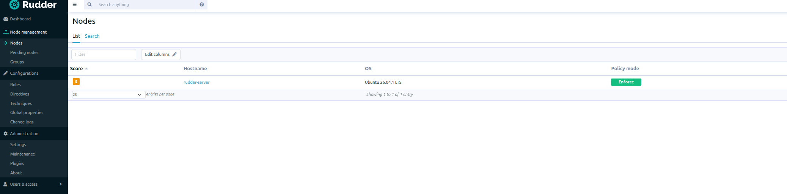
Extrêmement simple, le menu de gauche permet de naviguer entre :  
- Les **nodes** déjà intégrés (pour le moment, uniquement le serveur),  
- Les **nodes** en attente - **Pending Nodes** - (ceux qui viennent d'être déployés) Pour les faire disparaître, il suffit juste de cliquer sur **Accept**,  
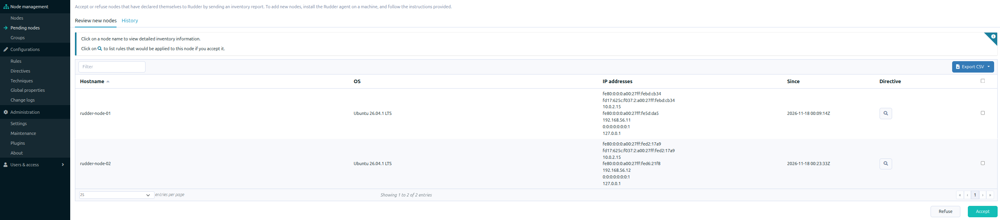
- **Groups** permet de créer des...groupes *statiques* ou *dynamiques* ou bien des *catégories*.  

Une fois tous les agents déployés et *acceptés* dans l'interface, voici à quoi ça ressemblera :  
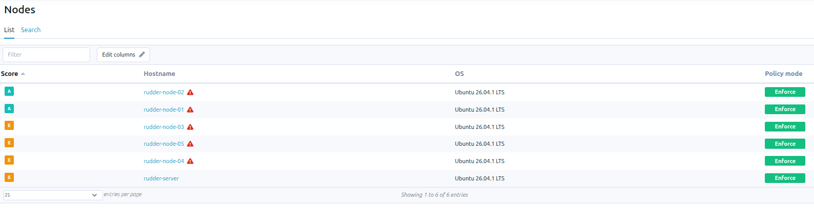

## Et le reste ?
### Les directives
On peut ajouter plusieurs *directives* sans avoir à créer de nouvelles *techniques*. L'exemple le plus concret serait le *durcissement SSH*, l'objectif est d'imposer les paramètres suivants :  

<table>
  <tr>
    <td><strong>Paramètre</strong></td>
    <td><strong>Valeur attendue</strong></td>
  </tr>
  <tr>
    <td>PermitRootLogin</td>
    <td>No</td>
  </tr>
  <tr>
    <td>PasswordAuthentication</td>
    <td>No</td>
  </tr>
  <tr>
    <td>X11Forwarding</td>
    <td>No</td>
  </tr>
  <tr>
    <td>AllowTcpForwarding</td>
    <td>No</td>
  </tr>
  <tr>
    <td>Fichier concerné</td>
    <td>/etc/ssh/sshd_config</td>
  </tr>
</table>

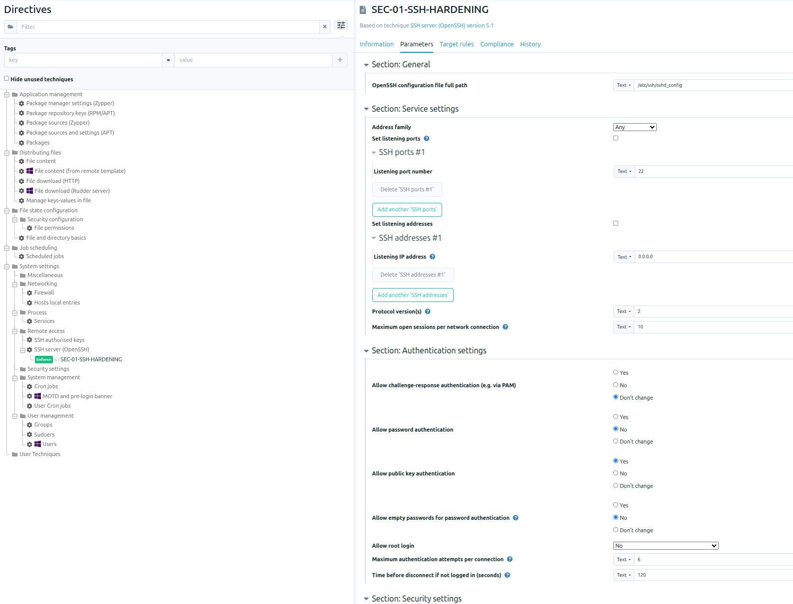

Le déploiement ou la suppression de packages répond au même principe, exemples : 
<table>
  <tr>
    <td><strong>Nom</strong></td>
    <td><strong>Paramètres</strong></td>
    <td><strong>Valeur attendue</strong</td>
  </tr>
  <tr>
    <td><strong>SYS-02-REMOVE-TELNET</strong></td>
    <td><strong>Package Name</strong></td>
    <td>telnet</td>
  </tr>
  <tr>
    <td></td>
    <td><strong>Package State</strong></td>
    <td>Absent</td>
  </tr>
  <tr>
    <td></td>
    <td><strong>Package Version</strong></td>
    <td>Any version</td>
  </tr>
  <tr>
    <td></td>
    <td><strong>Package Manager</strong></td>
    <td>Default package manager</td>
  </tr>
  <tr>
    <td><strong>SYS-02-DEPLOY-NGINX</strong></td>
    <td><strong>Package Name</strong></td>
    <td>nginx</td>
  </tr>
  <tr>
    <td></td>
    <td><strong>Package State</strong></td>
    <td>Present</td>
  </tr>
  <tr>
    <td></td>
    <td><strong>Package Version</strong></td>
    <td>Any version</td>
  </tr>
  <tr>
    <td></td>
    <td><strong>Package Manager</strong></td>
    <td>Default package manager</td>
  </tr>
  <tr>
    <td><strong>SYS-02-DEPLOY-UFW</strong></td>
    <td><strong>Package Name</strong></td>
    <td>ufw</td>
  </tr>
  <tr>
    <td></td>
    <td><strong>Package State</strong></td>
    <td>Present</td>
  </tr>
  <tr>
    <td></td>
    <td><strong>Package Version</strong></td>
    <td>Any version</td>
  </tr>
  <tr>
    <td></td>
    <td><strong>Package Manager</strong></td>
    <td>Default package manager</td>
  </tr>
</table>

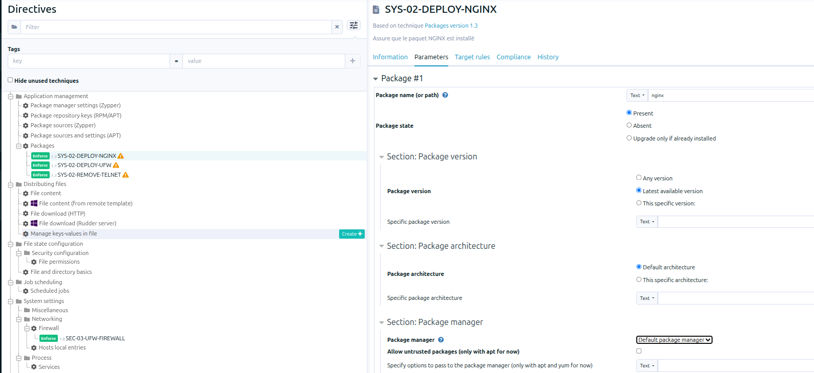

### Les techniques
Seules, les *techniques* ne servent pas vraiment...mais une fois créées, elles permettent de créer des *directives* qui peuvent être appliquées sur les serveurs cible, exemple avec la gestion du fichier *sysctl* (que j'ai décidé de nommer **SEC-04-KERNEL-HARDENING**).  
Les *techniques* sont livrées, par défaut, avec de nombreuses catégories de méthodes et, parmi elles, **sysctl value**.  
Le but est de pouvoir intégrer ce qui suit en tant que *directive* :  
```ini
# Protection contre les redirections ICMP
net.ipv4.conf.all.accept_redirects = 0
net.ipv4.conf.default.accept_redirects = 0

# Protection contre le spoofing
net.ipv4.conf.all.rp_filter = 1

# Désactivation des source-routed packets
net.ipv4.conf.all.accept_source_route = 0
net.ipv4.conf.default.accept_source_route = 0

# Protection contre les SYN cookies désactivée ? Non :
net.ipv4.tcp_syncookies = 1
```

La méthode **sysctl value** nécessite 3 paramètres :  
- **Key** : ici, on va pouvoir taper *net.ipv4.conf.all.accept_redirects* (par exemple),  
- **Value** : La valeur qui lui est associée (*0*),  
- **Filename** : Le fichier à modifier, il se trouve dans */etc/sysctl.d/*
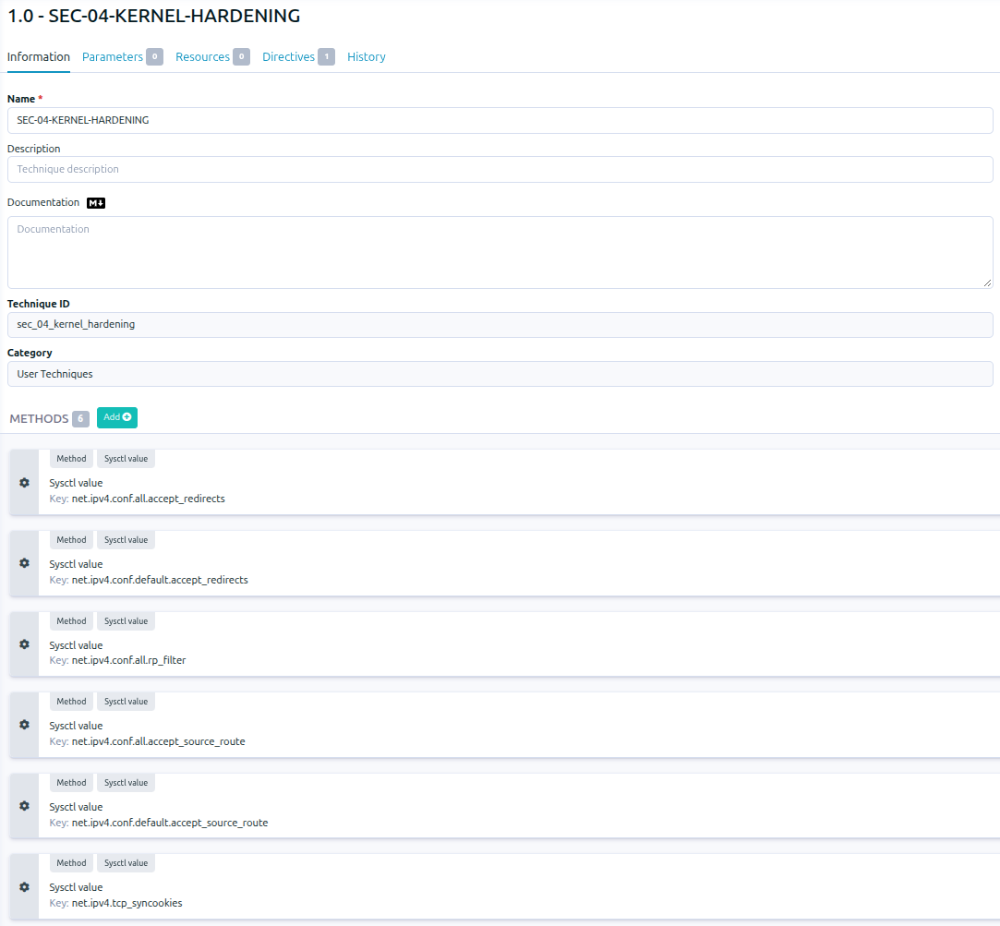
Une fois créée, la *technique* apparaîtra automatiquement dans les *directives*, au niveau **User Techniques** :  
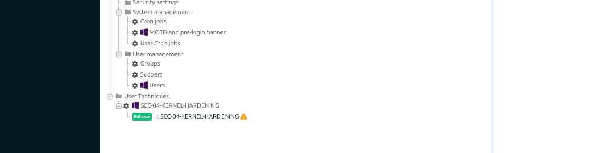

### Les rules
Les *rules* sont l'avant dernière étape avant l'application des nouvelles configurations et politiques de sécurité/compliance.  
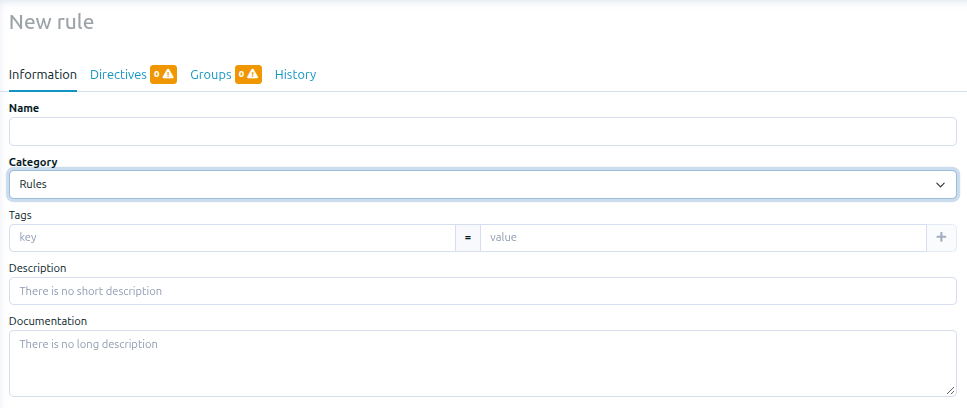
Dans le premier onglet, remplir uniquement le champ **Name**, les autres sont complètement optionnels.  

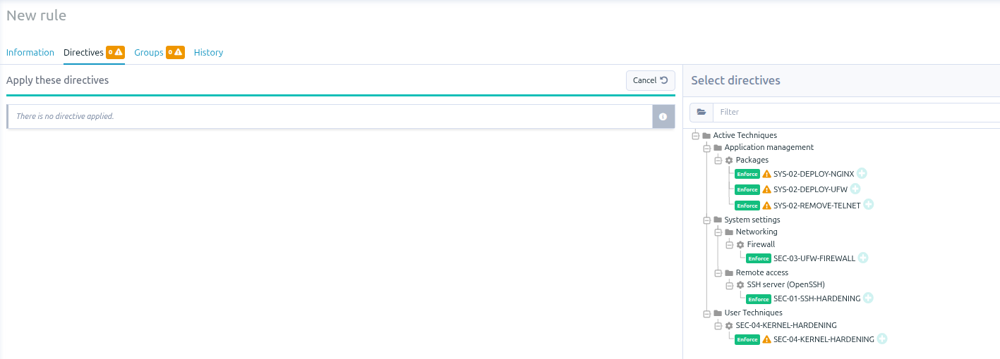  
Ici, il faudra sélectionner les *directives* qui devront être appliquées (en cliquant sur la croix verte à droite des *directives* affichées dans la liste) :  
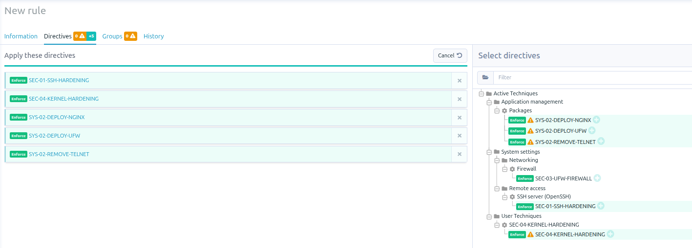

L'onglet **Groups** permet de sélectionner le group cible des *politiques/configurations* à appliquer :  
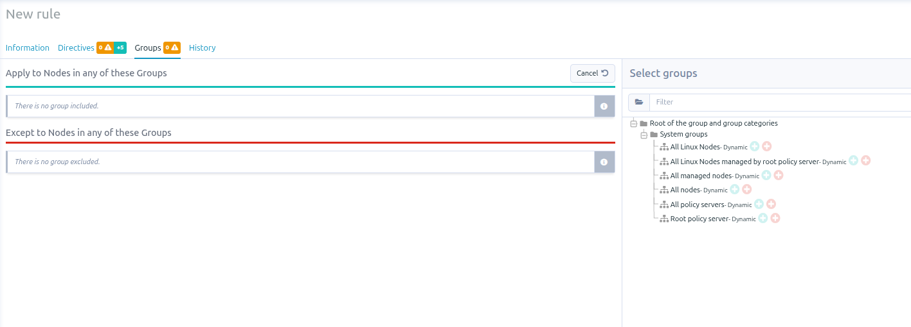
Si vous n'avez pas créé de groupe, *all managed nodes* est celui qui n'inclue pas le serveur **Rudder**.

# Et maintenant ?
Une fois la règle enregistrée, **Rudder** va régénérer les configuration applicables aux noeuds concernés...Il faut juste attendre quelques minutes, le temps que les agents exécutent l'application des politiques.

Ou bien...déclencher l'exécution manuellement via la commande `sudo rudder agent run` sur chaque noeud, en commençant par *rudder-server* puis *rudder-node-01* à *rudder-node-05*.

Pour voir le résultat de l'application de la nouvelle politique, il faut se rendre sur **Node Management** > **Nodes** : 
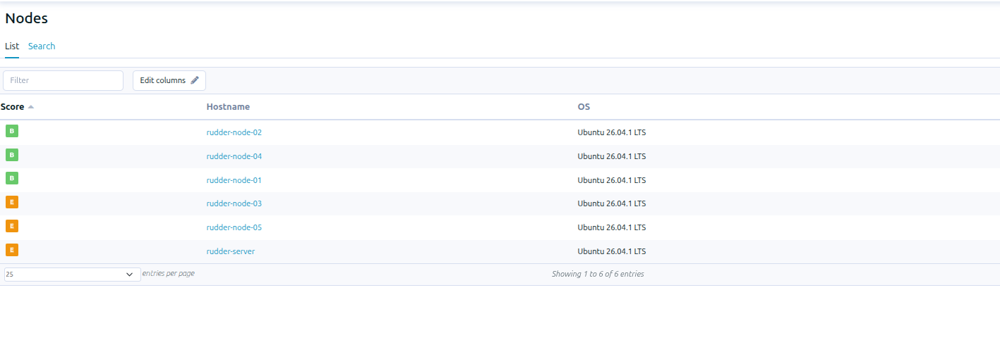
Puis cliquer sur un des noeuds, puis sur l'onglet **Compliance** : 
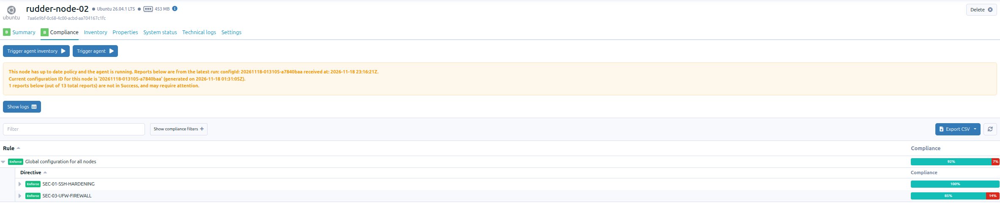

Les labs pour **Puppet**, **Chef**, **Salt** et **Ansible** vont suivre.