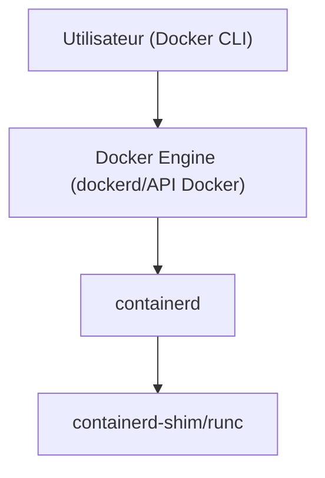
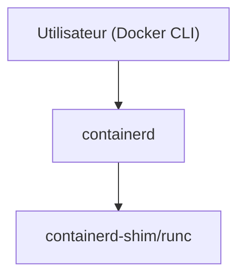

# Nerdctl

## Dis...c'est quoi cette bouteille de lait ?
**Nerdctl**...mais prononçons le *nerd control* (ce sera peut-être plus simple), est un outils en ligne de commande dont l'objectif est de proposer une expérience utilisateur proche de celle de Docker...en remplaçant **dockerd** par **containerd**.  
C'est bien là toute la subtilité puisque de nombreux **Cloud Provider** (dont **Google Cloud Computing**) ont fait le choix de déprécier le premier au profit du second dans leur dernière mise à jour de leur service **Kubernetes** managé.  

En pratique, **nerdctl** permet de gérer le cycle de vie des images, des conteneurs, du réseau et des volumes, il est également compatible avec Docker Compose ainsi qu'avec les fonctionnalités natives de **containerd** (à savoir l'isolation par namespaces, la compatibilité avec le *container runtime interface*, la gestion des snapshots ou la gestion des images au format **OCI**).  

Cependant ce n'est pas un moteur de conteneurs supplémentaire mais une interface de type **CLI** communiquant avec **containerd** s'adressant aux populations souhaitant manipuler des conteneurs sans passer par **Docker Engine**.

Le *bonus* ? C'est développé dans l'écosystème **containerd**...le même projet opensource soutenu par la **CNCF**.

## Follow the white rabbit...
Les présentations sont faites, mais concrètement comment **nerdctl** fonctionne exactement ?  
En fait, il s'appuie sur plusieurs composants différents :  
<table>
    <tr>
        <td><strong>Composant</strong></td>
        <td><strong>Rôle</strong></td>
    </tr>
    <tr>
        <td><strong>nerdctl</strong></td>
        <td>Interface CLI de manipulation des conteneurs</td>
    </tr>
    <tr>
        <td><strong>containerd</strong></td>
        <td>Runtime de gestion du lifecycle des conteneurs</td>
    </tr>
    <tr>
        <td><strong>containerd-shim</strong></td>
        <td>Processus intermédiaire de supervision des conteneurs</td>
    </tr>
    <tr>
        <td><strong>runc</strong></td>
        <td>Runtime OCI - créer et démarrer les conteneurs</td>
    </tr>
    <tr>
        <td><strong>Buildkit</strong></td>
        <td>Construction des images à partir des Dockerfile</td>
    </tr>
    <tr>
        <td><strong>CNI</strong></td>
        <td>Connectivité réseau</td>
    </tr>
    <tr>
        <td><strong>Snapshotter</strong></td>
        <td>Gestion des systèmes de fichiers et des couches d'images</td>
    </tr>
</table>

Si on devait comparer **Docker Engine** et **nerdctl**, ça donnerait ça :  
#### Architecture Docker Engine

#### Architecture nerdctl


Voila où se situe la différence fondamentale : **Docker Engine** n'est plus nécessaire entre l'utilisateur et *containerd*.

**nerdctll** dispose également de son propre mécanisme de *namespaces* dans le but de séparer les ressources gérées par le moteur et, par conséquent, distinguer les conteneurs administrés directement par **nerdctl** de ceux créés par **Kubernetes**.

## Comment ça s'installe ?
De ce côté là, pas de jaloux puisque **nerdctl** peut s'installer sur n'importe quelle distribution **Linux** mais également sur **Windows**, via **WSL** (évidemment) ou au sein d'une machine virtuelle, sur **MacOS**.  

Deux archives sont disponibles :  
- nerdctl-<VERSION>-linux-amd64.tar.gz,  
- nerdctl-full-<VERSION>-linux-amd64.tar.gz  

La seconde est idéale afin de mettre en place un environnement de test autonome car elle inclue les composants nécessaires tels que **containerd**, **buildkit**, les plugins **CNI** et **RootlessKit**.  

L'installation sur Linux :  
```bash
VERSION=<VERSION>

wget https://github.com/containerd/nerdctl/releases/download/v${VERSION}/nerdctl-full-${VERSION}-linux-amd64.tar.gz

sudo tar xzf /usr/local nerdctl-full-${VERSION}-linux-amd64.tar.gz

sudo systemctl enable --now containerd
```

Dans le cas d'un déploiement sur **Windows** (autre que via **WSL**), ce sera avec l'outils **Scoop**...et sur **MacOS**, faites-vous plaisir avec **brew** et **lima** (ce dernier intègre déjà **nerdctl**) :  
```bash
brew install lima

limactl start

lima nerdctl run -d --name nginx -p 8080:80 nginx:alpine
```

## Un air de Déjà-Vu...
On me dit dans l'oreillette que ça ressemble comme deux gouttes d'eau à l'expérience **Docker CLI** :   
<table>
    <tr>
        <td><strong>fonction</strong></td>
        <td><strong>Commande</strong></td>
    </tr>
    <tr>
        <td>Télécharger une image nginx</td>
        <td>nerdctl pull nginx</td>
    </tr>
    <tr>
        <td>Lister les images</td>
        <td>nerdctl images</td>
    </tr>
    <tr>
        <td>supprimer l'image nginx</td>
        <td>nerdctl rmi nginx</td>
    </tr>
    <tr>
        <td>Lancer un conteneur</td>
        <td>nerdctl run</td>
    </tr>
    <tr>
        <td>Afficherles logs</td>
        <td>nerdctl logs *CONTENEUR*</td>
    </tr>
    <tr>
        <td>Entrer dans un conteneur</td>
        <td>nerdctl exec -ti *CONTENEUR* bash</td>
    </tr>
    <tr>
        <td>Créer un volume et le rattacher à un conteneur lors de sa création</td>
        <td>nerdctl volume create data<br>nerdctl run -d --name data -v data:/var/lib/postgresql/data postgres:17</td>
    </tr>
    <tr>
        <td>Créer un réseau et rattacher un conteneur dessus</td>
        <td>nerdctl network create net1<br>nerdctl run -d --name app --network net1 nginx:alpine</td>
    </tr>
</table>

Comme expliqué lors de l'introduction, **nerdctl** est compatible avec **Docker Compose**, néanmoins il faudra valider la prise en charge des extensions et de l'ensemble des fonctionnalités avant toute exécution.  

J'avais également évoqué plus haut dans cet article une compatibilité avec **BuildKit**...pas de suprises de ce côté là, tout est compatible.

## Mais...c'est inédit !!!
Si **nerdctl** ne proposait aucune fonctionnalité vraiment inédite par rapport à **Docker Engine**, cet article n'aurait aucune raison d'exister...mais ce n'est pas le cas.  
Parmi les fonctionnalités les plus intéressantes, on peut trouver :  
- Le **mode Rootless** dont l'objectif est de limiter les risques associés à l'exécution de conteneurs avec des droits élevés sur l'hôte (un peu comme les privilèges sur **Kubernetes**),  
- Le **Lazy Pulling** (qui s'appuie sur plusieurs technologies de *snapshotter* et qui a besoin que l'un d'eux soit installé et configuré) dont le but principal est de réduire le temps de chargement des conteneurs,  
- Le **Support GPU** (nécessitant un environnement matériel spécifique) pour des cas d'utilisation lié principalement à l'*IA* ou au *Machine Learning*

## Que dire de plus ?
De toutes les informations que j'ai pu trouver sur le sujet, les fonctionnalités totalement inédites telles que la gestion multi-architectures, le rootless ainsi que la signature des images et le fait qu'il puisse travailler directement avec **containerd** (sans passer par des outils intermédiaires) sont de véritables atouts.  
D'autres articles sont prévus sur **nerdctl**, principalement des labs...ce n'est qu'un début.