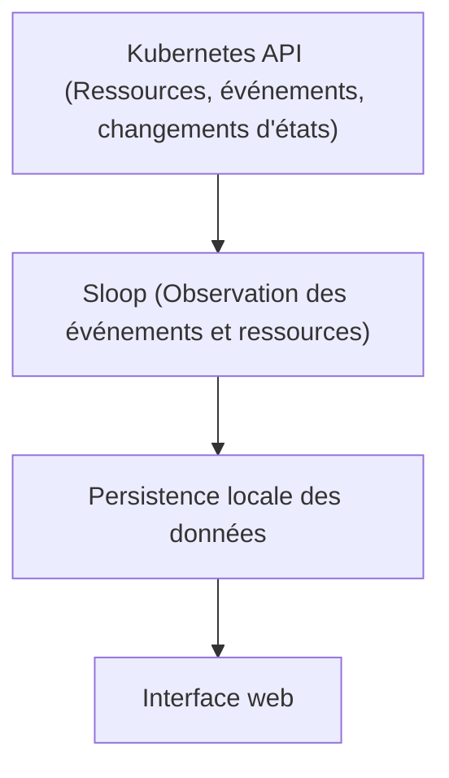
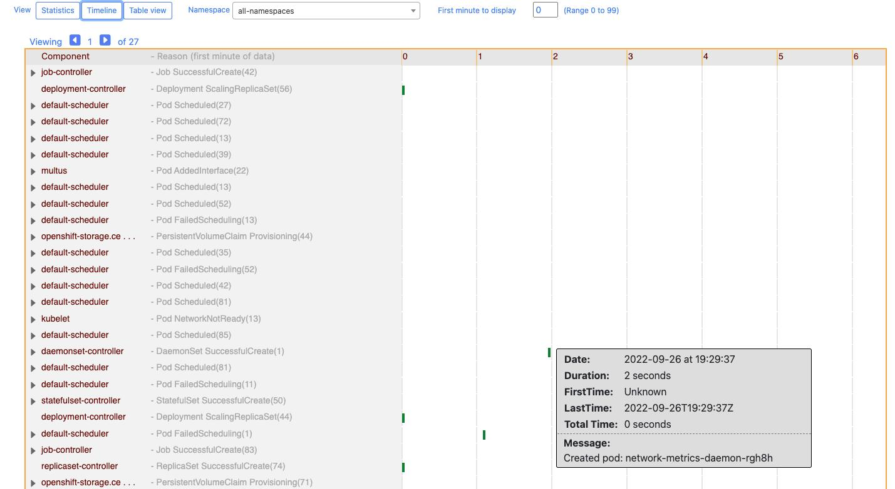

# Sloop

## L'histoire dans l'histoire

L'écosystème de **Kubernetes** est tellement vaste que presque tous les usages sont couvert...presque tous.  
Et quand une fonctionnalité native n'est couverte par un outils venant de ce même écosystème, c'est parce qu'un développeur n'a pas jugé pertinent...sauf les **events**.  
**Sloop** nous vient de **Salesforce**, il a pour but de conserver une trace des événements et des changements d'états des ressources afin d'avoir un aperçu de ce qui s'est passé à un moment donné.  
Mais ce n'est pas tout, il permet également d'investiguer et de diagnostiquer à l'aide d'une interface graphique.

## Docteur...dites-m'en plus...

En tant qu'outils complémentaire à **Kubernetes**, il surveille l'API, collecte les informations au *file de l'eau* et utilise un moteur de stockage embarqué, ce qui évite d'avoir à déployer une base de donnée ou à utiliser des resources externes au cluster.  



Un coup d'oeil aux objets surveillés par **Sloop** :  

|                           |                                    |
| ------------------------- | ---------------------------------- |
| **Ressources**            | **Intérêt**                        |
| **Pod**                   | Cycle de vie complet               |
| **Deployment**            | Update de configuration et rollout |
| **ReplicaSet**            | Création / Remplacement            |
| **StatefulSet**           | Evolution des instances            |
| **Job**                   | Exécutions / Evénements            |
| **PersistentVolumeClaim** | Update de configuration            |
| **Node**                  | Contexte d'exécution des workloads |

L'interface web de **Sloop** est certainement la fonctionnalité la plus intéressante, elle permet :  

- D'identifier le moment de création et suppression de pods,  
- D'observer l'évolution des déployments,  
- De suivre les événements liés aux jobs,  
- De comprendre la succession des opérations lors d'un incident



## L'indice est sous le pavé...

Il faut le dire : **Sloop** fonctionne comme **kube event**, mais de manière graphique...certains pourront dire que *c'est du bonbon pour les yeux*.
Parmis les fonctionnalités principales, on retrouve :  

- L'historisation des événements : **kube events** est pratique mais relativement limité en terme de stockage, grâce au moteur de stockage (sur lequel je reviendrais plus tard) les événements sont stockés plus durablement afin d'apporter une vraie valeur ajoutée en cas de diagnostic sur des pannes,  
- La recherches de ressources supprimées. Contrairement à la commande `kubectl get pods`, **Sloop** n'est pas limité aux ressources encore présente,  
- L'historique de déploiement, il permet notamment de visualiser les relations temporelles entre *deployment*, *replicaset*, *statefulset* et *pods* (entre autres),  
- La chronologie des événements, lors d'événements intermittent de type *redémarrage occasionnels de pods*, *un deployment qui ne pervient pas à atteindre un nombre précis de replicas*, *un problème durant un rollout*...**Sloop* est très utile pour cela.

Grâce au moteur de stockage intégré (il s'agit de **BadgerDB**), il n'y a pas besoin de déployer/maintenir de base **PostgreSQL**, **MongoDB** ou de cluster **ElasticSearch**. Le stockage étant local, il doit être évidemment persistant.  
Sans stockage persistant, les données stockées dans le volume mémoire du mode Docker documenté sont perdues au redémarrage.

La configuration de **Sloop** permet aussi bien de gérer l'aspect **stockage**, **rétention** ainsi que la **sauvegarde** et la **restauration**.

## Il va y avoir du sport...

En ce qui concerne l'installation, pas de soucis :  

- Le plus accessible, **Helm**...**Salesforce** propose un [chart officiel](https://github.com/salesforce/sloop/tree/master/helm/sloop?utm_source=chatgpt.com),  
- L'image Docker, pour le tester hors de **Kubernetes**,  
- Si vous aimez souffrir un peu, le projet est développé en Go et peut être installé depuis les sources :

```bash
mkdir -p $GOPATH/src/github.com/salesforce
cd $GOPATH/src/github.com/salesforce
git clone https://github.com/salesforce/sloop.git
cd sloop
make
```

Puis, pour le démarrer :  

```
$GOPATH/bin/sloop
```

## Let's end this

Sloop de Salesforce répond à une problématique réelle de l'exploitation Kubernetes : l'absence d'une vision historique suffisamment accessible pour comprendre les incidents passés.
Son principal intérêt est de permettre de reconstituer la chronologie des événements et des changements d'état des ressources Kubernetes.
Il n'a pas pour but de remplacer **Prometheus**, **Grafana** ou **Datadog**, **Dynatrace** et **Splunk** (pour les plus complets), ils sont complémentaires.  

D'autres articles sont prévus sur **Sloop**, principalement des labs...ce n'est qu'un début.